# Visual Postman Flows Guide

This guide explains how to construct and run the **Visual Postman Flow** for the Studio Fitness Booking system using Postman's visual low-code/no-code canvas.

---

## 1. Overview of the Flow Canvas

The visual flow connects blocks from the **`Studio Fitness Booking API`** collection to model the complete boutique fitness lifecycle:

```mermaid
flowchart LR
    Start(["Start Block"]) --> S1["Send: Login Staff"]
    S1 --> S2["Send: Register M1"]
    S2 --> S3["Send: Login M1"]
    S3 --> S4["Send: Register M2"]
    S4 --> S5["Send: Login M2"]
    S5 --> S6["Send: Create Studio"]
    S6 --> S7["Send: Schedule Class"]
    S7 --> S8["Send: Grant 10 Credits (M1)"]
    S8 --> S9["Send: Grant 10 Credits (M2)"]
    S9 --> S10["Send: M1 Books Class (Fills Spot 1)"]
    S10 --> S11["Send: Idempotency Replay"]
    S11 --> S12["Send: M2 Joins Waitlist"]
    S12 --> S13["Send: Verify M2 Uncharged (10)"]
    S13 --> S14["Send: M1 Cancels Booking"]
    S14 --> S15["Send: Verify M1 Refund (10)"]
    S15 --> S16["Send: Verify M2 Promoted"]
    S16 --> S17["Send: Verify M2 Charged (8)"]
    S17 --> S18["Send: Audit Ledger Check"]
    S18 --> Display(["Display Block: Flow Summary"])
```

---

## 2. Setting Up in Postman Flows (Visual Canvas)

### Step 1: Open Flows in Postman
1. In the left-hand navigation pane of Postman, click **Flows** (under Collections / APIs / Environments).
2. Click the **+ (Create Flow)** button to open a blank canvas.
3. Name your flow: **`Studio Booking & Waitlist Automation`**.

### Step 2: The Start Block
- A **`Start`** block is placed on the canvas automatically.

### Step 3: Adding "Send Request" Blocks
For each step:
1. Click the **+** (or drag out from the output port of the preceding block).
2. Select **Send Request**.
3. Choose the request from the collection:
   - Collection: **`Studio Fitness Booking API - End to End Collection & Flows`**
   - Folder: **`0. End-to-End Core Booking Flow (1-Click Automated Runner)`**
   - Select the respective Step request (`Step 01`, `Step 02`, ..., `Step 18`).

### Step 4: Connecting Success to Execution
- Drag a connection wire from the **`Success`** output port of each request block to the **`Input / Exec`** port of the next request block.
- Because the collection variables (`flow_staff_token`, `flow_m1_token`, `flow_class_id`, etc.) automatically propagate between steps, each block uses the live output from earlier steps seamlessly.

### Step 5: Terminal Display Block
1. From the output of **`Step 18: Audit Ledger Check`**, drag out a connection.
2. Search and select **Display**.
3. Connect the `Response Body` port to the Display block to render the formatted audit ledger summary on the canvas.

### Step 6: Run the Flow
Click the **Run (▶)** button on the bottom toolbar. Watch each block pulse green as execution flows across the canvas.

---

## 3. Flow Specification File

The machine-readable node and edge graph is saved in:
- [`studio_booking_flow.json`](./studio_booking_flow.json)

This file defines the 20 nodes (Start, 18 Requests, 1 Display) and the 19 connecting edges, positions $(x, y)$, and collection references.
